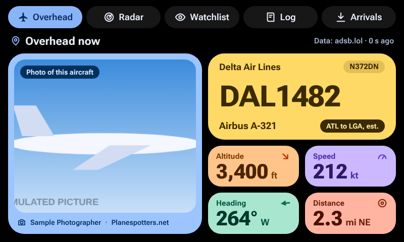
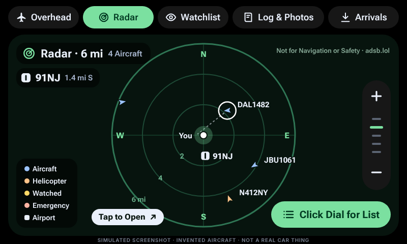
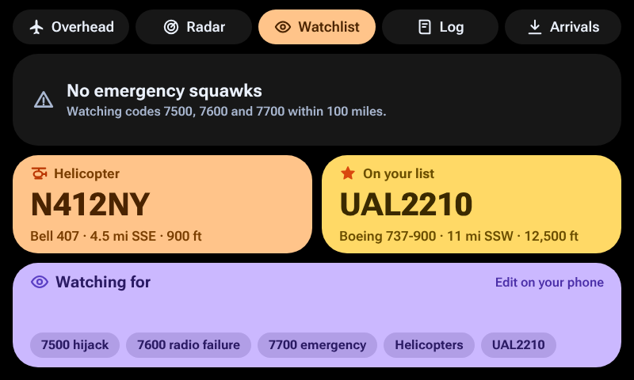
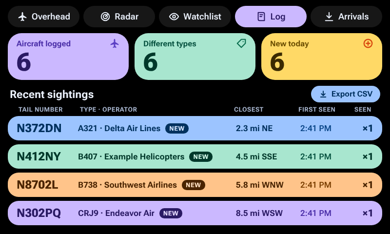
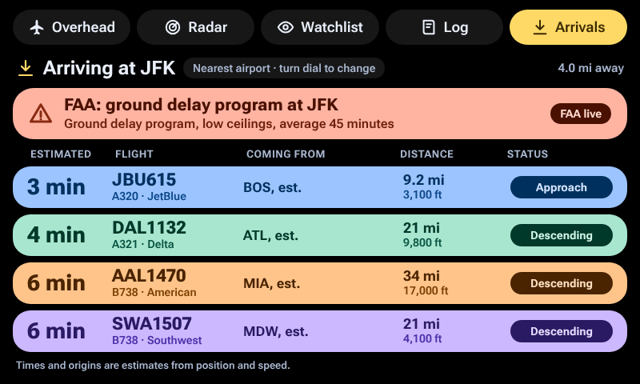

# Plane Thing

An aircraft spotter for the discontinued Spotify Car Thing, running on [bridgething](https://bridgething.com). Think of
wardriving for Wi-Fi, but for planes: drive around, and the Car Thing shows what is flying near you and keeps a log of every
aircraft you pass. Five screens, one for each button, in bright Material 3 Expressive colors on a black background. It is free,
has no accounts or API keys, and is open source.

> **Status: first release, lightly tested on a real device.** Version 0.1.0 has been built, type-checked and run in a
> simulator, and its 103 unit tests pass, but that used made-up data. Its owner has also driven with it on a real Car Thing
> for about a day and reports that it worked well, including photos of the actual aircraft. That is one person's one day:
> most of the [checklist](docs/device-test-checklist.md) has not been worked through, and exports have not been tried on a
> real phone. See [what has and has not been tested](docs/testing.md).
>
> **Built with AI assistance, under a person's direction.** Thomas Marlowe decided what to build and how it should behave,
> approved the designs and is testing it. Claude, an AI assistant made by Anthropic, wrote the code, tests and documentation.
> No human programmer has reviewed the code line by line. [Read exactly who did what.](docs/how-this-was-built.md)

Plane Thing is for fun and curiosity. Positions can be late, wrong or missing. **It is not for navigation or safety.**

## Screenshots

These are **pictures from the simulator, with invented aircraft and a sample photo**, not photos of a real Car Thing. They
will be replaced with real captures once device testing is done.

<table>
  <tr>
    <td></td>
    <td></td>
  </tr>
  <tr>
    <td></td>
    <td></td>
  </tr>
  <tr>
    <td></td>
    <td></td>
  </tr>
</table>

## The five screens

| Button          | Screen      | What it shows                                                                                       |
| --------------- | ----------- | --------------------------------------------------------------------------------------------------- |
| 1               | Overhead    | The closest aircraft within 10 miles: airline, tail number, callsign, type, estimated route, altitude, speed, heading, distance, and a photo with credit |
| 2               | Radar       | A scope of everything near you with five ranges, the nearest airport plotted with its code, and a list view |
| 3               | Watchlist   | Emergency squawks, helicopters, and the callsigns, tail numbers or types you list                   |
| 4               | Spotter log | Counts, recent sightings and what is new today. Export the whole log from your phone                |
| Recessed button | Arrivals    | Aircraft landing at the nearest airport with estimated times and origins, plus FAA delay status     |

An aircraft squawking 7500, 7600 or 7700 within 100 miles flashes EMERGENCY on whatever screen you are on and then jumps to
the Radar. A setting turns the jump off. The log keeps one row per aircraft, tail number included, and exports to CSV and KML
from the settings page on your phone.

Arrivals are **estimates** from position and speed, not airline schedules, which are paid data. The screen says "est." wherever
it is guessing.

## What you need

- A Car Thing running bridgething 0.16.0 or newer.
- The bridgething companion app on your phone, signed in to the internet, with location allowed. The phone does all the
  networking for the Car Thing.
- Aircraft that are in range of a volunteer's ADS-B receiver. Coverage is very good in North America and Europe and
  patchy elsewhere.

## Install

See [docs/install.md](docs/install.md). Short version: install it from the bridgething store once it is listed, or paste the
address of the version zip into the companion app's "install from url or file" panel (not yet tested on a real device).

- Catalog address, which the store reads: `https://tomarlowe.github.io/plane-thing/catalog.v1.json`
- Zip for version 0.1.0: `https://tomarlowe.github.io/plane-thing/r/01a1a8ce-5e3a-71a1-8619-b65be4e9d5d1/0.1.0.zip`

## Known limits

- **Lightly tested on hardware.** One day of driving went well, but the buttons, dial, touch, startup time, the emergency
  alert and exports have not been checked item by item on a real device. The Bluetooth link between the Car Thing and the
  phone dropped at times, which the owner believes is a bridgething matter and has not been investigated. The
  [checklist](docs/device-test-checklist.md) lists each item.
- **Only works while it is on screen.** There is no background logging while another app is shown.
- **Not every aircraft appears.** Only aircraft sending ADS-B within range of volunteer receivers are seen.
- **Photos have an unresolved terms problem.** Planespotters.net in particular asks for things the Car Thing cannot do, such
  as a clickable credit link. The [data sources page](docs/data-sources.md) explains what is open. Read it before
  redistributing the app.
- **The data services are free favors.** They can slow down, change or stop at any time, and their terms say personal,
  non-commercial use.
- **No drones** in version 1. See the [roadmap](docs/roadmap.md).

## Privacy

There is no account, no tracking and no analytics, and nothing is sent to the author. Your position goes to the flight data
services only as coordinates rounded to about 1 kilometer. Photo services see the aircraft's identifying numbers, not you. The
spotter log stays on your Car Thing until you export it. Full detail, including what the route lookup sends, is in
[docs/privacy.md](docs/privacy.md).

## Documentation

**Using it**

- [Install guide](docs/install.md)
- [User guide](docs/user-guide.md): every screen, every setting, how to export the log
- [Troubleshooting](docs/troubleshooting.md)
- [FAQ](docs/faq.md)
- [Privacy](docs/privacy.md)

**How it works and how it was made**

- [Architecture](docs/architecture.md): diagrams of the system, the data cycle and the release process
- [Design decisions](docs/design-decisions.md): what was decided, why, and by whom
- [Data sources, credits and terms](docs/data-sources.md): every service used, what it receives, and what its terms say
- [How this was built](docs/how-this-was-built.md): the role of the AI assistant and of the person directing it
- [Testing](docs/testing.md) and the [device test checklist](docs/device-test-checklist.md)
- [Roadmap](docs/roadmap.md): ideas, open problems and what is blocked

**Contributing**

- [Developer guide](docs/developer-guide.md): build it, change it, test it, ship it
- [Contributing](CONTRIBUTING.md), [code of conduct](CODE_OF_CONDUCT.md) and [security policy](SECURITY.md)
- [Changelog](apps/plane-thing/CHANGELOG.md)
- [Third-party notices](THIRD_PARTY_NOTICES.md)

## Contributing

Real-device test reports are the most useful thing right now. Bug reports, documentation fixes and code review are welcome too.
See [CONTRIBUTING.md](CONTRIBUTING.md). Please say in a pull request if an AI assistant helped write it.

## Credits

- Live aircraft positions: volunteer ADS-B receivers, shared by [adsb.lol](https://adsb.lol/) (Open Database License),
  [airplanes.live](https://airplanes.live/) and [adsb.fi](https://adsb.fi/)
- Photos: [Planespotters.net](https://www.planespotters.net/), [airport-data.com](https://www.airport-data.com/) and
  [Wikimedia Commons](https://commons.wikimedia.org/), credited beside each photo
- Airports: [OurAirports](https://ourairports.com/), public domain
- Delays: FAA National Airspace System status
- Fonts: [Roboto Flex](https://github.com/googlefonts/roboto-flex), SIL Open Font License
- Platform: [bridgething](https://bridgething.com)
- Plane Thing is not affiliated with Spotify, Anthropic, the FAA or any of the services above.

Every package and license is listed in [THIRD_PARTY_NOTICES.md](THIRD_PARTY_NOTICES.md).

## License

[MIT](LICENSE). The data services above have their own terms, summarized in [docs/data-sources.md](docs/data-sources.md). Several
of them limit their free access to personal, non-commercial use.
