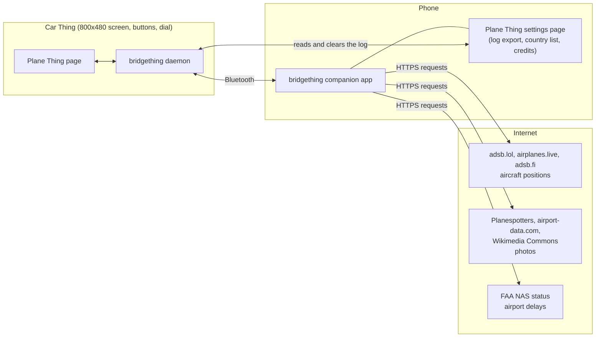
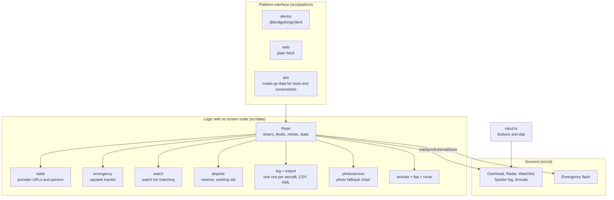
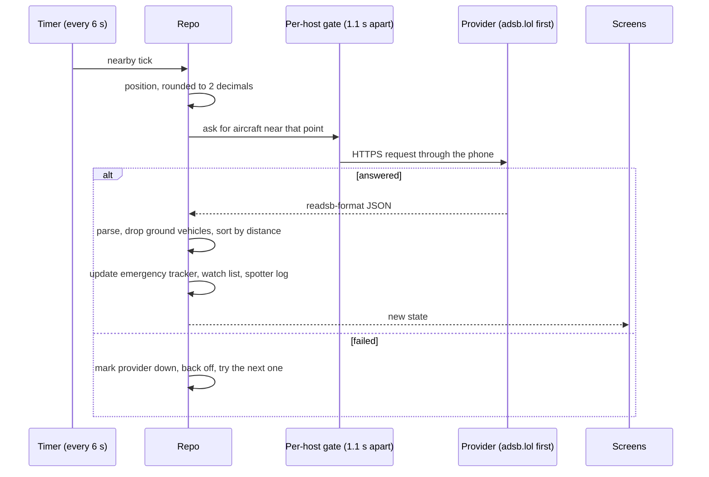
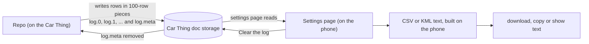
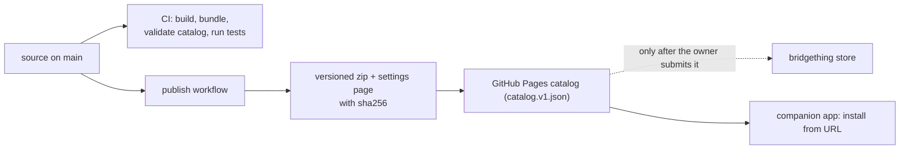

# Architecture

Plane Thing is a single web page that runs in the Car Thing's kiosk browser and gets everything from the outside world
through the phone. This page shows where each part lives and how data moves. For file-by-file notes see the
[developer guide](developer-guide.md), and for the reasons behind the choices see
[design decisions](design-decisions.md).

## The system

- The Car Thing has no internet connection of its own. Every request goes through the phone's companion app.
- The settings page is a second page, built separately, that the companion app shows on the phone. It reads and clears the
  spotter log that the Car Thing keeps, and it is the only place a file or a clipboard copy can be made.
- The airport list ships inside the app. Nothing about airports is fetched at run time.

## Inside the app

- **One interface for the outside world.** Everything the app needs from outside (fetching a web address, saving a
  value, reading settings, finding the position) goes through the `Platform` interface in `src/platform/types.ts`. There
  are three implementations: the real device, a plain browser, and a simulator that answers from made-up fixtures. That is
  why the whole app runs on a desktop and why the tests need no device or network.
- **One owner for state.** The `Repo` class owns every timer and every feed. Screens only read its state, so a screen
  never talks to the network.
- **Data logic is separate from drawing.** Everything in `src/data` is plain TypeScript with no screen code, which is what
  the unit tests cover.

## A data cycle

Other feeds run on their own timers: the emergency squawk search (25 s), arrivals (10 s), the FAA status (5 min) and
your position (8 s). Photos and routes are fetched one at a time when an aircraft needs them.

## The spotter log and the phone

The log is split into pieces of about 100 rows because the device stores each piece as one document with a size limit.
The phone builds the export itself, so the log never leaves the Car Thing except as a file you choose to save or copy.
Clearing the log from the phone removes the pieces and then the index, and the app notices the index is gone and empties
its own copy.

## Build and release

Bundles are reproducible: the same source gives the same file digest. A published version is immutable, so every change
needs a new version number. See the [developer guide](developer-guide.md#releasing).

## Technology

- TypeScript, React 19 (the settings page uses Preact to stay small), Vite 8, Bun for scripts and tests.
- The radar scope is drawn as SVG by the app. There is no map library and no map tiles.
- Roboto Flex is bundled with the app, so no font is downloaded at run time.
- Runtime packages are listed in [THIRD_PARTY_NOTICES.md](../THIRD_PARTY_NOTICES.md).
